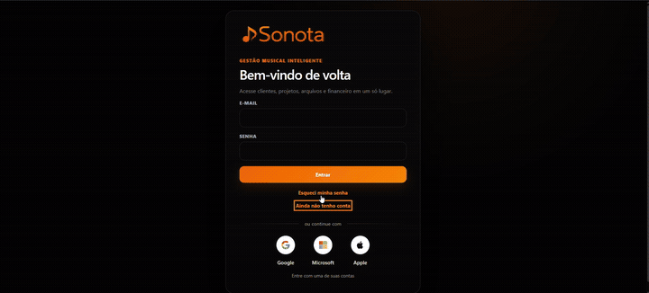

# Sonota

Aplicação de apoio à rotina de um estúdio musical. O Sonota reúne clientes, projetos, biblioteca de arranjos e acompanhamento financeiro em uma interface web; busca inteligente, assistente e processamento de áudio complementam o fluxo de trabalho.

> **Importante:** contas e perfis usam Firebase. Já clientes, projetos, arranjos, documentos e arquivos são mantidos localmente em SQLite e no disco da instalação. Esses dados operacionais não são sincronizados entre computadores.

## Demonstração



## Funcionalidades

- **Acesso e perfil:** autenticação com Firebase, perfil de usuário e opções de login por provedores sociais, conforme a configuração habilitada no Firebase.
- **Clientes e projetos:** cadastro e consulta de clientes, acompanhamento de projetos por etapas e espaço de trabalho com histórico e versões de entregas.
- **Biblioteca musical:** cadastro de arranjos e arquivos, metadados como BPM, tonalidade, gênero, instrumentos e tags, além de filtros e reprodução.
- **Dashboard e financeiro:** indicadores da operação, prazos, alertas, valores previstos e recebimentos associados aos projetos.
- **Busca e assistente:** busca textual/contextual; recursos com IA local via Ollama são opcionais e dependem da instalação e configuração dos modelos.
- **Laboratório de áudio:** fila para análise, separação de stems e transcrição MIDI/partitura. O processamento requer dependências Python e modelos apropriados; não é necessário para usar as funções centrais de gestão.
- **Arquivos e exportação:** armazenamento privado local, anexos relacionados a projetos e exportação de registros da conta em JSON.

Os botões de Google, Microsoft e Apple estão previstos na interface, mas o login efetivo depende de cada provedor estar habilitado e configurado no Firebase. A integração precisa ser validada no ambiente em que o aplicativo será executado.

## Tecnologias

| Área | Tecnologias identificadas |
| --- | --- |
| Interface web | Angular 20, Ionic 8, TypeScript, HTML e CSS |
| API e servidor | Node.js 24, Express 5 |
| Persistência | SQLite para dados operacionais locais; Firebase Authentication e Firestore para contas e perfis |
| Aplicativos e distribuição | Capacitor para projetos Android/iOS; Tauri e scripts de instalador para Windows |
| Recursos opcionais | Ollama para IA local; worker Python com Demucs, Basic Pitch, librosa e music21 para operações de áudio |

O uso de IA e processamento de áudio é opcional. Dependendo da operação, o ambiente também precisa das ferramentas indicadas em [`audio/README.md`](audio/README.md).

## Arquitetura e estrutura

O frontend Angular é compilado para `public/ionic/` e servido pelo backend em `/app/`. O backend Express também disponibiliza a API em `/api/`. O diretório `public/` mantém a interface web anterior como fallback.

```text
mobile/                 Interface Ionic Angular e configuração Capacitor
src/                    API Express, autenticação, domínio, busca e integração com IA
src/migrations/          Migrações do banco SQLite
public/                 Arquivos estáticos e interface anterior
audio/                  Worker Python e requisitos de processamento de áudio
desktop/                Configuração do shell Tauri
installer/windows/      Scripts de geração do instalador Windows
tests/                  Testes automatizados
docs/                   Documentação técnica e decisões do projeto
```

Embora o acesso e os perfis sejam gerenciados pelo Firebase, os dados de produção e os arquivos permanecem no computador que executa o Sonota. A configuração atual não representa sincronização desses dados entre instalações.

## Instalação e execução

## Acesse o Site
- Entre no link [Link para baixar o Sonota](https://sonota-app.vercel.app)
- E faça o download do software.

## OU

### Pré-requisitos

- Node.js **24.x** e npm.
- Acesso à internet para instalar dependências.
- Credencial administrativa do Firebase autorizada para o projeto configurado, necessária para a integração do servidor com os dados de perfil.

O processamento de áudio e os recursos de IA têm requisitos adicionais descritos em [`audio/README.md`](audio/README.md) e no arquivo de exemplo de configuração [`.env.example`](.env.example).

### Instalar

Na raiz do repositório, execute o setup. Ele cria `.env` a partir do exemplo, preservando um arquivo existente, instala as dependências da raiz e de `mobile/` usando os lockfiles e compila a interface.

**Windows (PowerShell):**

```powershell
npm.cmd run setup
```

**Linux ou macOS:**

```sh
npm run setup
```

O arquivo `.env` está incluído no `.gitignore` e não deve ser enviado ao repositório. Use o `.env.example` para demonstrar as variáveis necessárias sem incluir credenciais reais. As credenciais administrativas do Firebase devem permanecer privadas.

### Iniciar o aplicativo

```powershell
npm.cmd start
```

Em Linux/macOS, use `npm start`. Com o servidor em execução, acesse <http://localhost:3000/app/>.

Para desenvolver a interface com atualização automática, mantenha o backend em um terminal e, em outro, execute:

```powershell
npm.cmd run ui:dev
```

Abra <http://localhost:8100/>. Em Linux/macOS, use `npm run ui:dev`.

### Build e verificações

```sh
npm run ui:build
npm test
npm run check
```

O build da interface é necessário para servir a versão Angular em `/app/`. `npm test` executa os testes Node.js; `npm run check` executa as verificações de código definidas pelo projeto.

Há também scripts de empacotamento para Windows em [`installer/windows/`](installer/windows/). A geração do instalador requer ambiente Windows e depende das ferramentas e downloads descritos em [`installer/windows/README-DESKTOP.md`](installer/windows/README-DESKTOP.md). As configurações Capacitor estão presentes, mas a publicação de apps nativos requer ferramentas específicas de cada plataforma e validação adicional.

## Aspectos técnicos e aprendizados

Pela arquitetura e documentação do repositório, os principais pontos técnicos são a integração entre uma interface Angular e uma API própria, a separação entre perfis remotos no Firebase e dados operacionais locais, e a execução assíncrona de tarefas de áudio com dependências externas. A busca semântica também pode depender de um serviço Ollama local.

Esses pontos descrevem decisões e dependências observáveis no projeto; não representam um relato pessoal de desafios resolvidos ou de resultados de produção.


## 🤝 Créditos e Colaboração

O **Sonota** foi desenvolvido de forma colaborativa pela equipe **Harmônico**, com o objetivo de criar uma plataforma inteligente para auxiliar profissionais da música na gestão de suas atividades.

### 👨‍💻 Minha Contribuição — Diego Oliveira Camargo

Durante o desenvolvimento do Sonota, fui responsável principalmente pela **estruturação do banco de dados e pela implementação do sistema de autenticação**, além de colaborar na integração dessas funcionalidades com o back-end da aplicação.

**Principais responsabilidades:**

- 🗄️ **Banco de Dados:** estruturação e implementação da persistência de dados utilizando **SQLite**, contribuindo para o armazenamento e gerenciamento das informações do sistema.
- 🔐 **Autenticação:** implementação da autenticação de usuários com **Firebase Authentication**, contribuindo para o controle de acesso à plataforma.
- ⚙️ **Integração Back-end:** colaboração na integração do banco de dados e da autenticação com os demais componentes da aplicação.

### 👥 Trabalho em Equipe

O desenvolvimento do Sonota contou com a colaboração dos integrantes da **Harmônico**, envolvendo planejamento, desenvolvimento de interfaces, implementação de funcionalidades e integração de diferentes tecnologias.

Cada integrante contribuiu para a evolução do projeto, permitindo a construção de uma solução integrada para a gestão musical.

---

**Desenvolvido pela equipe Harmônico.**

**Contribuição de Diego Oliveira Camargo:** Banco de Dados, Autenticação e Integração Back-end.

## Status

Os manifests e o changelog identificam esta base como **V3.2.0**. Isso indica a versão registrada no repositório, não uma afirmação de que o projeto esteja concluído ou homologado em todos os ambientes. Login social, processamento de áudio, IA e empacotamento dependem de configuração e validação adicionais.

Consulte [`CHANGELOG-V3.2.0.md`](CHANGELOG-V3.2.0.md), [`docs/API.md`](docs/API.md) e [`AC02-VALIDACAO.md`](AC02-VALIDACAO.md) para detalhes relacionados a esta versão.

## Sobre e contato

**Diego Oliveira Camargo** — formado no Ensino Médio Técnico em Desenvolvimento Web pela FIAP School.

- GitHub: [DiegoOLiveiraCamargo](https://github.com/DiegoOLiveiraCamargo)
- LinkedIn: [diegooliveiracamargo](https://www.linkedin.com/in/diegooliveiracamargo/)
